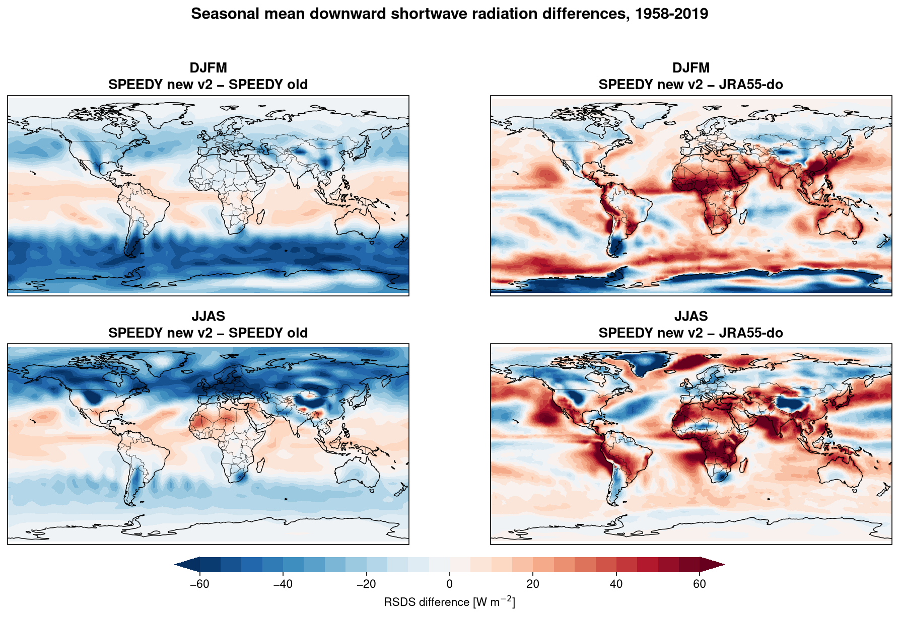
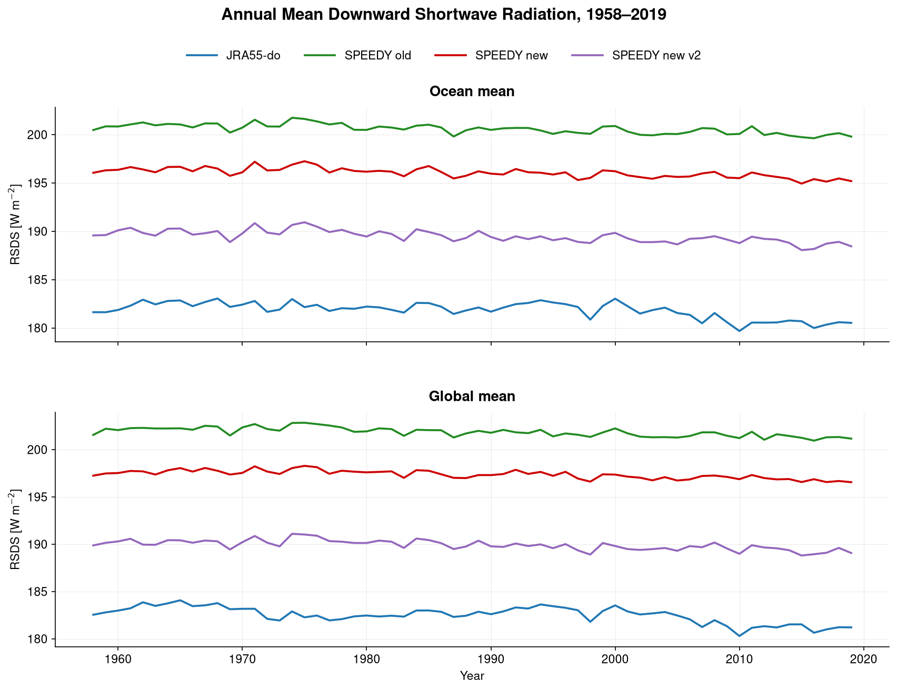
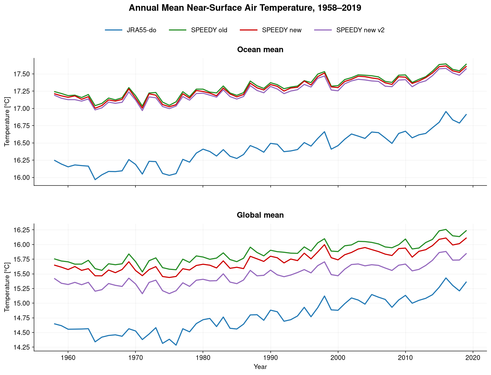

# SPEEDY Cloud Albedo Experiments

## Comparison with JRA55-do (1958–2019)

Two cloud albedo correction experiments against JRA55-do atmospheric forcing.

**JRA55-do** - Reference 
**SPEEDY old** - Original SPEEDY configuration without cloud albedo corrections 
**SPEEDY new** - First cloud albedo correction experiment 
**SPEEDY new v2** - Updated cloud albedo parameterization (ascending, 

### Ocean Mean

| Dataset | RSDS (W/m²) | Bias vs. JRA55 (W/m²) |
|:--------|------------:|----------------------:|
| **JRA55-do** | 181.833 | — |
| SPEEDY old | 200.581 | +18.748 |
| SPEEDY new | 196.047 | +14.213 |
| **SPEEDY new v2** | **189.476** | **+7.643** |

### Global Mean

| Dataset | RSDS (W/m²) | Bias vs. JRA55 (W/m²) |
|:--------|------------:|----------------------:|
| **JRA55-do** | 182.513 | — |
| SPEEDY old | 201.856 | +19.343 |
| SPEEDY new | 197.359 | +14.846 |
| **SPEEDY new v2** | **189.908** | **+7.395** |

### RSDS Bias Reduction

| Region | SPEEDY old (W/m²) | SPEEDY new v2 (W/m²) | Reduction |
|:-------|------------------:|---------------------:|----------:|
| Ocean | +18.748 | +7.643 | **59.2%** |
| Global | +19.343 | +7.395 | **61.8%** |

## Annual Mean area-weighted Near-Surface Air Temperature (TAS)

### Ocean Mean

| Dataset | Temperature (°C) | Bias vs. JRA55 (°C) |
|:--------|-----------------:|--------------------:|
| **JRA55-do** | 16.404 | — |
| SPEEDY old | 17.319 | +0.915 |
| SPEEDY new | 17.293 | +0.890 |
| **SPEEDY new v2** | **17.258** | **+0.854** |

### Global Mean

| Dataset | Temperature (°C) | Bias vs. JRA55 (°C) |
|:--------|-----------------:|--------------------:|
| **JRA55-do** | 14.783 | — |
| SPEEDY old | 15.858 | +1.075 |
| SPEEDY new | 15.733 | +0.950 |
| **SPEEDY new v2** | **15.480** | **+0.697** |

### Temperature Bias Reduction

| Region | SPEEDY old (°C) | SPEEDY new v2 (°C) | Reduction |
|:-------|----------------:|-------------------:|----------:|
| Ocean | +0.915 | +0.854 | **6.7%** |
| Global | +1.075 | +0.697 | **35.2%** |

## Summary

The cloud albedo corrections lead to improvements in both downward shortwave radiation and near-surface air temperature.

| Metric | SPEEDY old bias | SPEEDY new v2 bias | Improvement |
|:-------|----------------:|-------------------:|------------:|
| Ocean RSDS | +18.748 W/m² | +7.643 W/m² | 59.2% |
| Global RSDS | +19.343 W/m² | +7.395 W/m² | 61.8% |
| Ocean TAS | +0.915 °C | +0.854 °C | 6.7% |
| Global TAS | +1.075 °C | +0.697 °C | 35.2% |
